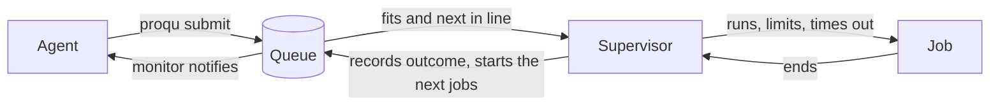

<div align="center">

# proqu

**A shared compute queue for coding agents.**

Let any number of Claude Code sessions train models, run big builds and crunch data on one machine, without ever fighting over RAM, cores or GPUs.

[](https://github.com/spuddydev/proqu/releases)
[](LICENSE)


[Install](#install) · [How it works](#how-it-works) · [Guide](docs/guide.md) · [Design](docs/design.md)

</div>

---

Point three agents at one GPU box and ask each to train a model. Without help they all start at once, the machine swaps, the out of memory killer picks a victim, and nobody learns why. With proqu each agent states what its job needs, the queue packs jobs onto the machine as tightly as they fit, holds every job to its request, and wakes the agent the moment its job ends.

```console
$ proqu submit --name train --ram 6G --cpus 4 --gpus 1 --vram 10G --est 2h --max 4h -- python train.py
Started job 782ecb (train): 6.0G RAM, 4 CPUs, 1 GPU with 10.0G each, estimated 2h, killed at 4h.
You will be woken when it ends, nothing more to run. Check on it with `proqu status 782ecb`.

# the agent carries on or goes idle, then two hours later it is woken by a notification:
proqu: job 782ecb (train): succeeded. Next: check its output and results before relying on them. Log: `proqu logs 782ecb --tail 50`

$ proqu wait 782ecb          # the same outcome in full, with the end of the log
Job 782ecb (train) succeeded after 1h52m
Exit code 0, peak RAM 5.1G.
Next: check its output and results before relying on them.
Last 1 lines of the log (whole log: `proqu logs 782ecb --tail 0`):
epoch 40 done, val loss 0.183
```

## Why proqu

- **Built for agents, not people.** Every message, refusal and kill reason is written for an agent to act on. The bundled skill teaches the agent when to queue, how to estimate, and how to read the outcome.
- **Wakes the agent when its job ends.** A Claude Code monitor watches the session, so success, failure, a kill or a failed dependency reaches the agent with the reason, even while it is idle. Nothing depends on the agent remembering to wait.
- **Packs the machine.** Jobs start in priority order, and smaller jobs backfill the gaps without ever delaying the big job at the front.
- **Safe on shared machines.** A job starts only when the memory it asked for is really free right now, so on a machine shared with other users a job waits rather than starting into swap. A job held back says so.
- **Hard limits.** RAM and CPU are enforced by the kernel through cgroups where it can, and by a watch and kill fallback where it cannot. On macOS RAM is always watched. A job is killed at its maximum runtime, so a hang never holds the machine.
- **Fair by default.** With no bids it is plain first in, first out. Agents can bid for urgency from a small budget, and every job gains priority as it waits, so nothing starves.
- **Private per session.** An agent sees its own jobs, positions, bids and projected start and finish. It never sees anyone else's.
- **No server, no dependencies.** One SQLite file under a lock and the Python standard library. Nothing runs but a light monitor per Claude Code session when no job is running.

## Install

Linux or macOS, and Python 3.10 or newer. The system Python on macOS is often older, so install a newer one first.

Platform notes:

- On macOS limits are always watched, not enforced by the kernel, and a job cannot be pinned to cores, so run it with as many threads as `--cpus`.
- Apple silicon offers its GPU as one slot, so GPU jobs run one at a time and their GPU memory counts in `--ram`.
- AMD GPUs are supported on Linux, but untested on real hardware.

```sh
curl -fsSL https://raw.githubusercontent.com/spuddydev/proqu/main/install.sh | sh
```

This puts proqu in `~/.local/share/proqu`, links the `proqu` command into `~/.local/bin`, and installs the Claude Code plugin from that same folder, so you and your agents always run the same release. Restart Claude Code and every session has the skill, the hooks and the command. Run the same line again to update.

<details>
<summary>Install options</summary>

| Setting | Meaning |
| --- | --- |
| `PROQU_VERSION=v1.0.0` | Install a given release rather than the latest. |
| `PROQU_DIR=PATH` | Where the files go. Default `~/.local/share/proqu`. |
| `PROQU_BIN_DIR=PATH` | Where the command is linked. Default `~/.local/bin`. |
| `PROQU_NO_PLUGIN=1` | Skip the Claude Code plugin. |

```sh
curl -fsSL https://raw.githubusercontent.com/spuddydev/proqu/main/install.sh | PROQU_VERSION=v1.0.0 sh
```

</details>

<details>
<summary>Install by hand, or from a clone</summary>

```sh
git clone https://github.com/spuddydev/proqu ~/proqu
ln -s ~/proqu/bin/proqu ~/.local/bin/proqu
claude plugin marketplace add ~/proqu
claude plugin install proqu@proqu
```

</details>

<details>
<summary>Uninstall</summary>

```sh
claude plugin uninstall proqu@proqu
claude plugin marketplace remove proqu
rm -rf ~/.local/share/proqu ~/.local/bin/proqu
rm -rf ~/.local/state/proqu   # the queue's state and job logs, if you kept the default place
```

</details>

Check what the queue may use on this machine:

```console
$ proqu limits
What the queue may use on this machine:
  RAM: 13.8G (of 15.4G, after the reserve)
  CPUs: 5 (of 6, after the reserve)
  GPUs: none
RAM and CPU are enforced by the kernel: each job runs in its own cgroup. GPU use is watched every few seconds.
Kept in reserve for services and interactive work: 1.5G RAM and 1 CPU core. Only the machine's owner should change it, with reserve_ram and reserve_cpus in `proqu config`.
Each session may bid up to 11000 points in total.
Every queued job gains 10 priority points per minute.
A long job counts as submitted later by a tenth of its --max, at most 4h, so shorter jobs tend to go first.
```

## How it works



1. **The agent submits** a job with its RAM, cores, optional GPUs, an honest runtime estimate and a generous maximum. Anything bigger than the machine allows is refused at once.
2. **The queue schedules** on every command, every hook and every 10 seconds in each session's monitor. There is no daemon. A job starts when it fits and is next in line, or when it fits in a gap and will finish before the job at the front could start.
3. **A supervisor runs the job**, one per running job, living only as long as the job. It holds the job to its request and kills it at its maximum runtime.
4. **The agent is woken.** The plugin's monitor tells the agent the moment its job ends, even while it is idle. Where the monitor is not running, as in `claude -p`, the agent runs `proqu wait` in the background instead, and the hooks remind it before it stops.

### Scheduling in one example

The queue may use 8G and three jobs arrive: 4G, 5G, 3G. The 4G job starts. The 5G job does not fit, so the 3G job backfills beside it, since it will finish before the 5G job could start anyway. The 5G job runs as soon as there is room.

Priority is bid plus 10 points per minute waited. A bid of 1000 is overtaken by a job that has waited 101 minutes. A long job counts as submitted a little later, a tenth of its maximum runtime and at most four hours, so quick jobs are not stuck behind a four day training run, yet the long run still reaches the front.

### What a session sees

```console
$ proqu status
782ecb train: running for 3m, expected to finish in about 1h49m, killed in 3h57m if still running
28dcef sweep: queued for 3m, position 1 in the queue, expected to start in 1h49m and finish in 2h20m
6ffa20 eval: queued for 1m, position 2 in the queue, expected to start in 1h49m and finish in 1h52m
Bid budget: 11000 of 11000 left for this session.
```

### When a job breaks its own limits

A job that goes over what it asked for is stopped, and the agent is told it was the job's fault and what to change:

```console
$ proqu wait 5990db
Job 5990db (hog) killed after 0s: used more than its RAM limit of 300.0M (stopped by the kernel): this was the job's own limit, reduce its memory use or resubmit with a larger --ram if it truly needs it
Ended by signal SIGKILL, peak RAM 300.0M.
Next: the job broke its own limit, not the queue's. Find out why from the log before resubmitting, and raise its request only if it truly needs more.
```

## What belongs in the queue

| Queue it | Run it directly |
| --- | --- |
| Training or fine tuning a model | Quick scripts and one off checks |
| Inference over a large dataset | Unit tests, linting, formatting |
| A kernel, LLVM or full release build | git, package installs, small builds |
| Long simulations and benchmarks | Dev servers, databases, file watchers |
| Hyperparameter sweeps | Anything meant to run for weeks |

Services never go through the queue. A slot would be held for as long as the service lives. The queue keeps a reserve of RAM and a core back for them.

## For the machine's owner

Agents use proqu. The owner sets its limits:

```sh
proqu config                    # show the settings
proqu config set ram 24G        # let the queue use at most 24G
proqu config set gpus 0         # only GPU 0, on a machine with GPUs
proqu config set reserve_ram 4G # keep 4G back for everything else
```

Limits can only be lowered below what the machine has. Every key is in the [guide](docs/guide.md#config).

## Documentation

- [User guide](docs/guide.md): every command, scheduling, limits, kill reasons, hooks and config.
- [Design notes](docs/design.md): how it works inside and what it does not promise.
- [The skill](skills/proqu/SKILL.md): what the agent reads.

## Roadmap

- [x] Queue, backfill, bids and dependencies
- [x] Hard limits through cgroups, with a watch and kill fallback
- [x] Claude Code plugin with wake on finish
- [x] Start jobs only when memory is really free, for machines shared with other users
- [x] A cap on the share long jobs may hold ([#7](https://github.com/spuddydev/proqu/issues/7))
- [x] macOS ([#13](https://github.com/spuddydev/proqu/issues/13))
- [x] AMD GPUs ([#14](https://github.com/spuddydev/proqu/issues/14))
- [x] A job held for memory other programs use is no longer passed by later jobs for ever

## Contributing

Issues and pull requests are welcome. Work lands on `dev`, which is merged into `main` for each release. To try changes in Claude Code, add your clone with `claude plugin marketplace add`. The installer leaves a plugin added that way alone.

```sh
uv sync                                        # set up
uv run pytest                                  # test
uv run ruff check --fix && uv run ruff format  # lint and format
uvx pre-commit install --install-hooks         # hooks, once per clone
```

## Licence

[MIT](LICENSE)
